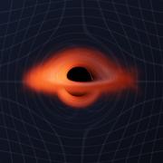
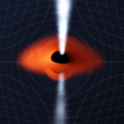
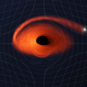
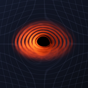

# Accretion

A black hole that lives on your desktop.

It's a real, ray-traced black hole that sits on top of your screen and bends whatever is behind it, the way gravity
bends light. You can drag it, throw it, and feed it your windows, files, pictures and text. It's also a pet: it gets
hungry, sleepy and bored, makes friends with other black holes, has babies, keeps a journal, and has moods that you can
see in how it looks and moves.

Nothing it eats is harmed. Eating is purely visual: windows are hidden and come back when it spits them out (and always
when Accretion closes, even after a crash). Files are never moved, changed or deleted.

| | | | |
| :---: | :---: | :---: | :---: |
|  |  |  |  |
| The black hole | Relativistic jets | A companion star | A banded disk |

## Install

Download **Accretion Setup** from the [Releases](../../releases) page and run it. It adds Accretion to the Start menu
and the desktop.

Windows may show a SmartScreen warning ("Windows protected your PC"), because the installer isn't code-signed. Choose
**More info → Run anyway**.

Windows 10 or 11, 64-bit. A graphics card from the last ten years or so is plenty.

## Using it

| Do this | And it |
| --- | --- |
| Drag it | moves. Let go while moving to throw it. Shift + drag moves it slowly. |
| Hold it still over a window, then let go | eats the window. |
| Drag things onto it | eats them: files, folders, pictures, text, links, 3D models, zip files. |
| Circle its edge slowly with the cursor | purrs (you're petting it). |
| Scroll on it | gets heavier or lighter. |
| Double-click it | gets a snack. Shift + double-click: watch it tear a star apart. |
| Ctrl + drag from it | follows the path you draw, eating what the path runs into. |
| Shake it up and down | drops what it ate. Side to side makes it queasy. |
| Right-click it | menu: name it, spit things out, share it, settings, close. |
| Ctrl + Alt + Z | spits out the last thing it ate. |

Open Accretion again to add another black hole (up to four). Settings has everything else, including a self-test that
checks your setup. Some things are hidden. Try things.

## Privacy

Accretion looks at your screen to bend it, and a few features listen for things (the beat of music playing, how fast
you're typing, two typed phrases). All of that stays on your PC and nothing is collected or uploaded. The only thing
that goes online is the update check. Details: [PRIVACY.md](PRIVACY.md).

## Building from source

You need [Node.js](https://nodejs.org/) 20 or newer and the [.NET 9 SDK](https://dotnet.microsoft.com/download).

```bash
npm install
```

Build the screen-capture helper (once, and again after changing it):

```bash
cd capture-helper
dotnet publish -c Release -o ../capture
```

Run it:

```bash
npm start
```

(`Accretion.bat` does the same, and installs dependencies first if needed.)

### How it's put together

| | |
| --- | --- |
| `main.js` | The app: windows, menus, the tray, feeding, settings, saving, updates. |
| `index.html` | The black holes: the ray tracer (WebGL), physics, the pets' lives, sound. One transparent window per monitor. |
| `settings.html`, `tour.html`, `card.html`, `rename.html` | The other windows. |
| `contents.js` | Reads 3D models and zip contents (for eating them). |
| `capture-helper/` | A small C# program: fast screen capture (DXGI), and hiding/showing windows and desktop icons. |
| `tools/` | Make the app icon and the previews of unlockable looks. |

The light paths near each black hole follow the exact equations for a spinning (Kerr) black hole; further out, the
well-known weak-field formula takes over.

## Plugins

Put `.json` files in `%APPDATA%\Accretion\plugins` to add your own looks and food rules. They're data only (no code
runs from them). There's an example in that folder after the first launch.

## License

Copyright © 2026 the Accretion authors.

Accretion is free software: you can redistribute it and/or modify it under the terms of the
[GNU General Public License](LICENSE), version 3 or (at your option) any later version. In short: you can use, change
and share it, but you must keep the credit and this license, and anything you build from it and share must be open
source under the same terms.
